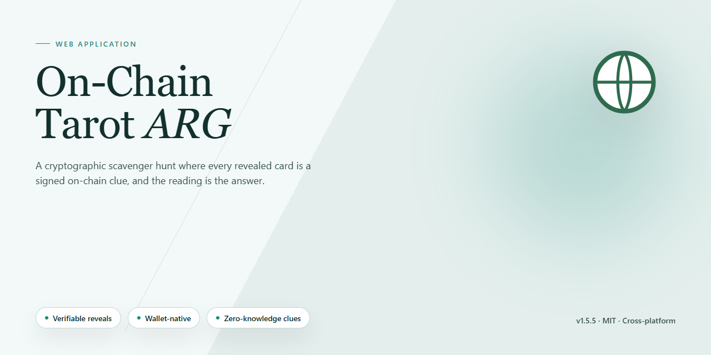

# 🔮 On-Chain Tarot ARG — Web Application

### ⌨️ PowerShell Command Button

   

---

On-Chain Tarot ARG is a living tarot mystery played out across the chain, where every card drawn and every riddle solved becomes part of a verifiable, unfolding story. Each day reveals a new chapter, and each is sealed, so nothing about the game's rests on trust. The experience blends tarot symbolism, cryptographic proof, and community play into a single continuous narrative you can check for. It is built for players who want their puzzles to matter and for skeptics who want the receipts to hold up.

## 📋 System Requirements

- **OS:** Windows 10 / 11
- **Shell:** PowerShell 5.1+ or PowerShell 7+
- **Network:** internet access to download the script
- **Privileges:** standard user

## Features

* **A Daily Ritual, On-Chain:** Every day unfolds as a self-contained chapter — a tarot card, a riddle, and a deadline. The isn't a matter of opinion; it's a fact recorded on-chain, giving each puzzle a concrete, verifiable resolution.
* **, Don't Trust:** The fingerprint is published. Anyone can recompute the hash locally and confirm the day was fair — black box, "trust the team" required.
* **A Chain That Can't Be Rewritten:** Each day's becomes the next day's link. Changing one entry means breaking every link that follows, making the entire season a tamper-evident record of play.
* **Multichain by Design:** Built across and, with explorers acting as part of the gameplay rather than an afterthought. The chain itself is a tool you can read.
* ** Dependencies, Full Transparency:** The verification layer runs on nothing but Node — installs, hidden packages. The same principle applies inside the game: public bots run on a memory that physically contains.
* **Anti-Spoiler Architecture:** Bots only in direct messages. Official channels never carry solutions. The design makes leaking an structurally impossible, not just against the rules.
* **Progressive Rights, Earned Not Bought:** Community standing grows through proven play and verified participation — not through payment, not through buying votes. prize path has a handle you could pull with money.
* **Deterministic:** randomness anywhere a prize is decided. The day's card derives by formula from four publicly revealed founding cards — recomputable by anyone, without us.
* **A Season That Up:** Day pages unlock as the season progresses, breakdowns follow each seal, and the full corpus releases at the end. What's hidden now is hidden by design, not by promise.

## How It Works

Every day, the game gives you three things and asks for one: a card from the deck, a riddle drawn from on-chain fact, and a fixed window in which to. What you do with them is the whole game — the app is the stage, not the referee.

The rhythm is deliberately small. A card and its chapter arrive, the riddle a few minutes later, and for the next stretch players work the same puzzle in public, argue over the same fork, and commit the same one-shot guess the window closes. timer pressure tricks, streak mechanics that punish a missed evening — just a clean daily decision that resolves on its own.

aren't a vote and aren't a raffle. Each day's solution is a short, checkable fact — something that already exists in the, whether on-chain or in the game's own published record — so the moment the seal lands, anyone can retrace the reasoning and confirm they were right or wrong without asking us. The seal announces *how many* were correct, never *who*. The cards do the talking; the tally stays anonymous.

The mechanic that makes this more than a quiz is the chain. any submission is accepted, the day's is fingerprinted and published. That fingerprint becomes part of the next day's link, and the next. Nobody — including us — can quietly rewrite yesterday without leaving a visible tear in every day that follows it. The whole progression is a single unbroken thread you can pull from either end.

That's the shape of a single day. Over the season the deck builds: cards unlock in order, chapters connect, and the early riddles quietly plant facts the later ones assume you remember. Play daily and the story assembles itself around you; skip a week and you can still read the archive, because nothing is locked behind a streak. The record stays even when you're not.

Prizes and rewards only ever route through that same verifiable ledger. There is random draw in any path where something is decided, way to pay for a better or a heavier vote, and hidden randomness to audit after the fact. If a player wins, the chain already explains why — and if it doesn't, that's a bug, not a mystery.

Under the hood it's deliberately thin: a daily pipeline that normalizes the, hashes it against a fresh salt, and threads the result into the ongoing chain. Everything the app computes, you can recompute. The polish you see on screen is just a friendly surface over the same plain rules — which is exactly why the surface can be trusted.

## Tech Stack

Built for a game where every claim can be checked, the On-Chain Tarot ARG runs on a deliberately lean, transparent stack. There is hidden service layer, opaque backend, and dependency sprawl standing between a player and the proof.

At its core sits a dual-chain foundation spanning and. Both networks carry the season's public record — mint and freeze authorities are revoked and visible in any explorer, so the guarantee that one can quietly alter the deck is a property of the chain itself, not a promise from the team. Multichain from day one means the audience meets the game where it already lives.

The verification layer is intentionally minimal: a handful of small Node command-line tools with dependencies. Normalization, fingerprinting, the day chain, and the 2-of-2 seal are each exposed as self-tests, so a skeptic can recompute the entire story locally without installing anything beyond a current Node runtime. The same tooling that builds the public export scans the tree for, salts, and anything ships — the export pipeline and the verification pipeline are the same pipeline.

Around the game, lightweight JavaScript powers the player-facing surfaces: day pages, breakdowns after each seal, and the official bots. Those bots run on a memory that physically contains, which is why anti-spoiler protection is structural rather than disciplinary. Telegram serves as the community and notification channel, with delivered only in direct messages.

Everything is source and educational by design — anywhere a prize is decided, handles to pull, and black boxes labeled "trust the team." The stack is small on purpose, because a game about verifiable should be verifiable down to its last dependency.

## FAQ

**Is On-Chain Tarot ARG free to play?**
Yes. Every riddle, every card, and every layer of the trail is to everyone. There are paywalls, premium tiers, and purchases that influence outcomes.

**Do I need a wallet to participate?**
A wallet lets you claim your place in the season and interact with the on-chain layers, but the puzzles themselves are solvable by anyone with a browser. Start reading, start solving, and connect when you're ready to go deeper.

**How do I know the aren't being changed behind the scenes?**
They can't be. Each day's fingerprint is published and locked into a hash chain — altering any past day would visibly break every day that follows it. The verification tools ship with the project so you can check the entire chain, without trusting anyone.

**What happens if I submit a wrong?**
Nothing punitive — you simply try again on a future day. The seal records how many players answered correctly, never who, so there's leaderboard shame and penalty for experimentation.

**Is there randomness in how prizes are decided?**
. Every card is derived by formula from publicly revealed founding cards, and every outcome is recomputable from published data. There is anywhere a prize is decided.

**Can I buy an advantage?**
— and not because we promise not to sell one, but because the mechanics have lever to pull., slots, and weighting aren't purchasable by design.

**How long does the season run?**
Seventy-eight days, one card per day, each with its own chapter, riddle layer, and fork. The full arc unfolds in real time.

**Where do I follow along between days?**
Official channels carry the daily card, the riddle's layer, and the community fork. stay out of public space entirely — they live in direct messages only, keeping the trail spoiler-free for everyone.

**What if I fall behind?**
Nothing closes. Past days remain readable, and the chain remains verifiable from day one. Catch up at your own pace — the trail isn't going anywhere.

**Who is this for?**
Puzzle players, tarot enthusiasts, on-chain communities, skeptics, and builders who like their games verifiable. If you've ever wanted a mystery you could audit, this is it.

## License

On-Chain Tarot ARG is released under the MIT License — a permissive, business-friendly license chosen deliberately for a product built on verifiability. The full source, the verification tooling, and the day-chain logic are for anyone to inspect, fork, and build on, because trust in this game should come from reading the code, not from taking our word for it.

**What this means in practice:** you can use, copy, modify, merge,, distribute, sublicense, and sell copies of the software, provided the copyright notice and permission notice are preserved. There is warranty — the software is provided "as is" — and liability is assumed by the authors for how it is used or deployed.

The MIT License applies to the code and documentation in this repository. It does not grant rights to the game's name, brand assets, or the seasonal corpus, which remain the intellectual property of the project. If you are building a derivative experience, keep the mechanics and give your own work its own name.

For commercial integrations, white-label deployments, or licensing questions beyond the scope of MIT, reach out to the maintainers directly. We are supportive of builders extending the format and happy to discuss terms that keep the spirit of verification intact.

This product is distributed with the expectation that transparency is a feature, not a concession. The license reflects that commitment: minimal restrictions, maximal inspectability, and a clear boundary between the source and the brand it powers.